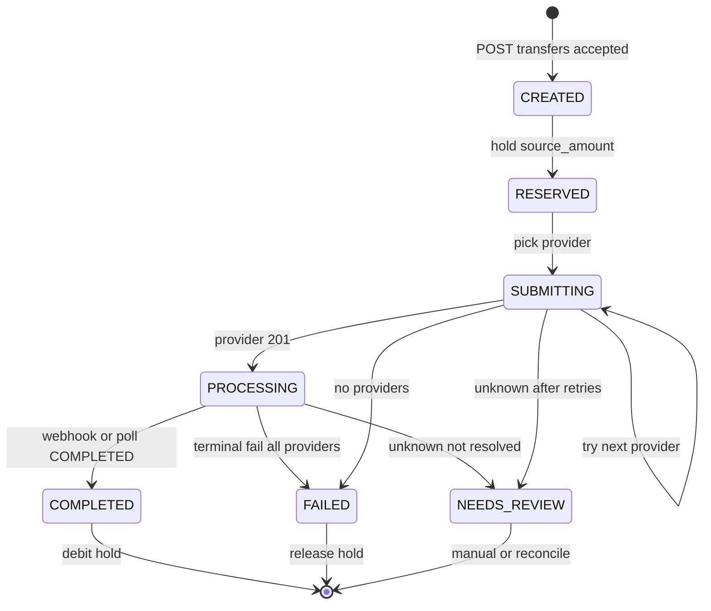

# DECISIONS.md — Transfer Core

Что решили, почему, и как устроена система. Дополняется при реализации (раздел «ИИ»).

## 1. Стек и запуск

- **Go + PostgreSQL** — compose уже поднимает PG; mock-provider на Python, контракт HTTP стабилен.
- **Один `docker compose up`** — Dockerfile для `api`, healthcheck db + mock.
- **Данные** — read-only `/data`; клиенты seed при первом старте в ledger.

## 2. Денежная арифметика

Единая функция округления `Round(v, currency)` — ROUND_HALF_UP к `minor_units` из `currencies.json`.

**SOURCE forward**

1. `fee_raw = amount × percent/100 + fixed` в валюте `charged_in`
2. `fee = Round(fee_raw, fee_currency)` с `fee = max(min, fee)`
3. Если charged_in SOURCE: `convert = amount - fee`; если TARGET: `convert = amount`, target_gross = convert×rate, fee от target_gross
4. `target = Round(convert × rate, target_currency)`

**TARGET inverse**

- Аналитическая оценка source по формуле комиссии (с веткой min fee и charged_in TARGET), ROUND_HALF_UP к minor source.
- Forward-проверка с коррекцией шагом 1 minor: вверх, пока `target < requested`; вниз — только пока `target > requested`. Точное совпадение target останавливает коррекцию, минимальный source не ищем (example 03 → 299900.00, а не 299899.99).
- Лимиты source проверяются по итоговому source.

**Курсы:** GET mock `/rates`; свежесть ≤6h; direct, inverse, one-hop cross — как ASSUMPTIONS.

## 3. HTTP API (поведение)

| Решение | Выбор | Почему |
|---------|-------|--------|
| POST /transfers | **202 Accepted** + `{transfer_id, status}` | slow 30s; клиент poll GET |
| Идемпотентность | Таблица `idempotency_keys` → сохранённый HTTP snapshot | L3 double submit |
| Quote expired на transfer | 422 `QUOTE_EXPIRED` | PDF код |
| Нет провайдера | 422 `NO_PROVIDER_AVAILABLE` до insert transfer | chaos_run api_errors |

Детальные схемы — `specs/transfer-core/contracts/openapi.yaml`.

## 4. State machine



| Переход | Инициатор |
|---------|-----------|
| CREATED→RESERVED | API handler (sync) |
| RESERVED→SUBMITTING | Worker |
| SUBMITTING→PROCESSING | Provider client 201 |
| PROCESSING→COMPLETED/FAILED | Webhook handler / reconcile poll |
| SUBMITTING→SUBMITTING | Provider decline/5xx/skip |
| *→NEEDS_REVIEW | Worker после policy unknown |

**Terminal:** COMPLETED, FAILED, NEEDS_REVIEW.

## 5. Ledger

Типы проводок: `seed`, `reserve`, `release`, `debit`.

- Reserve: `available -= S`, `reserved += S`
- Release: обратно при FAILED
- Debit: `reserved -= S` при COMPLETED

Инвариант: сумма seed = available + reserved + debited_completed.

Блокировка: `SELECT … FOR UPDATE` на строке balance клиента в транзакции POST /transfers.

## 6. Выбор провайдера

**Filter:** direction_id, enabled, not maintenance, payout limits (convert target→provider currency ±10%), margin ≥ min_margin_percent.

**Score** (maximize):

- `0.40 × norm(lowest_cost) + 0.35 × success_rate_24h + 0.25 × norm(1/latency)`

**Order:** descending score; fallback on failure.

**Margin fallback:** если все primary отсеяны по margin — FAILED с `NO_PROVIDER_AVAILABLE`; если primary принял и упал — можно пробовать следующего даже ниже margin (ASSUMPTIONS 6.4).

## 7. Provider client

- POST `{MOCK}/ {id}/payouts` с Idempotency-Key = `{transfer_id}:{attempt_no}`
- reference = transfer_id
- callback_url из `API_PUBLIC_URL/webhooks/{provider_id}`
- Timeout connect/read: 10s / 35s
- Outcome classes — ASSUMPTIONS §7

**Unknown:** poll GET by reference с backoff до visibility; не переключать провайдера пока не доказано отсутствие payout.

## 8. Webhook

- Verify HMAC-SHA256 hex body, secret env
- Dedup `(provider_id, event_id)` unique
- Apply status only if advances monotonicity (PROCESSING→COMPLETED/FAILED); ignore stale PROCESSING after terminal
- Unknown payout → 200 no-op

## 9. Reconcile worker

- Interval 30s: transfers PROCESSING > 2 min → poll provider
- On startup: resume SUBMITTING/PROCESSING
- Match chaos_run review states

## 10. Daily limit

UTC day bucket per client; sum gross source_amount transfers not FAILED; convert via rates service if limit currency differs.

## 11. Схема БД (основные таблицы)

- `quotes` — snapshot расчёта, expires_at
- `transfers` — quote_id, client_id, status, amounts
- `transfer_transitions` — from, to, at, reason
- `provider_attempts` — provider_id, idempotency_key, payout_id, result
- `client_balances` — client_id, currency, available, reserved (minor int)
- `ledger_entries` — audit
- `idempotency_keys` — key, request_hash, response_body, status_code
- `webhook_events` — provider_id, event_id, payload, processed_at
- `daily_usage` — client_id, date, amount_minor, currency

## 12. Структура Go-пакетов

```
cmd/api/main.go
internal/calc/       — fee, forward, inverse
internal/rates/      — fetch, stale, convert
internal/quote/      — persistence, TTL
internal/transfer/   — state machine
internal/ledger/
internal/provider/select/
internal/provider/client/
internal/webhook/
internal/reconcile/
internal/httpapi/
internal/store/      — postgres repos
```

## 13. Синхронный slow (30s)

Клиент получает **202** с `status=PROCESSING` сразу после reserve; worker ждёт провайдера/async webhook. Клиент не держит HTTP 30s.

## 14. ИИ-инструменты

| Инструмент | Для чего |
|------------|----------|
| Cursor Agent | SDD-артефакты, orchestration |
| (заполнить при implement) | |

### Где ИИ ошибся (заполнить при implement)

- **TARGET-режим (ASSUMPTIONS 1.5, T1-04 → T1-08).** На этапе ASSUMPTIONS ИИ сформулировал правило «минимальный `source_amount` (шаг 1 minor), дающий `target ≥ запрошенного`» и сослался на example 03 как подтверждение, не проверив, что минимальный source там другой. Для T=124068.63 THB минимальный source — 299899.99 RUB (fee 4498.49985 → 4498.50, target 124068.6258 → 124068.63), а example ожидает 299900.00. T1-04 реализовал и зафиксировал тестом именно минимальный вариант, поэтому расхождение не было видно до T1-08, где тест обработчика сверил ответ POST /quotes с example 03 (`source_amount` и `amount_to_convert` на 0.01). Исправлено amend-ом: аналитический обратный расчёт + forward-проверка (DECISIONS §2, ASSUMPTIONS 1.5). Урок: каждое `[VERIFY]`-допущение с ссылкой на example проверять численно до написания кода.

## Gate 2

- SPEC AC покрыты компонентами §12
- contracts/openapi.yaml согласован с chaos_run полями
- **После approval:** contracts FROZEN v0.1.0
